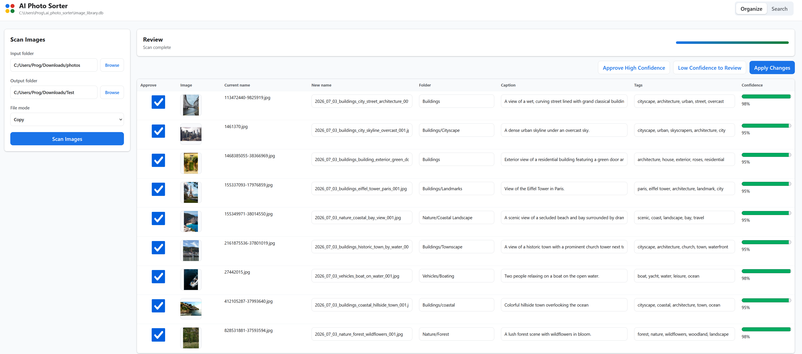
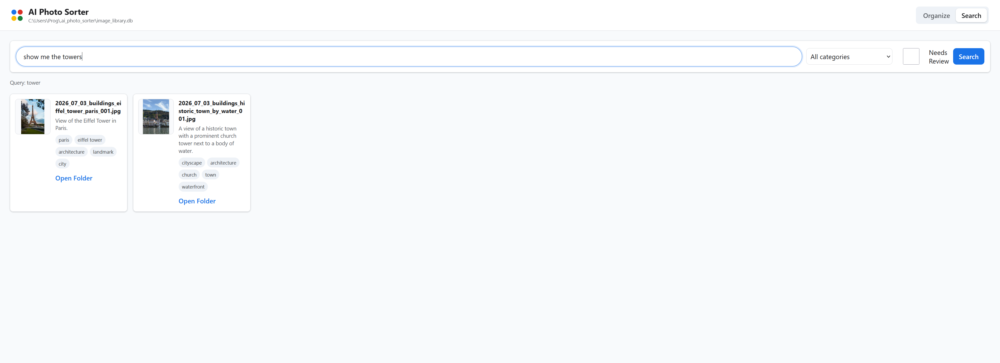

# AI Photo Sorter

AI Photo Sorter helps non-technical users organize messy photo folders automatically using private, local AI. It scans images, suggests useful names, creates folders, writes tags to a searchable database, and lets users search their library in plain English.

## Screenshots





## User Install

Normal users should receive one of these files from the `release` folder:

- Windows: `AIPhotoSorterSetup-0.2.2.exe`
- macOS: `AIPhotoSorterInstaller.dmg` or `AIPhotoSorter.pkg`

The Windows installer and macOS package installer put the app in the normal system location, show a setup message, and download:

- llama.cpp runtime binaries
- `gemma-4-E4B-it-Q4_K_S.gguf`
- `mmproj-F16.gguf`

The model and projector are large, roughly 5.8 GB together, so first install can take a while. If setup is interrupted, run the installer again to retry the automatic local AI preparation.

The app checks hardware automatically. NVIDIA systems use a CUDA llama.cpp build; Apple Silicon uses the macOS accelerated build; other systems fall back to CPU.

## Build Installers

Windows:

```powershell
powershell -NoProfile -ExecutionPolicy Bypass -File .\installer\windows\build_windows_installer.ps1
```

macOS:

```sh
sh installer/macos/build_macos_installer.sh
```

See [installer/README.md](installer/README.md) for packaging details.
The `.github/workflows/build-installers.yml` workflow can also build and upload Windows and macOS installer artifacts from GitHub Actions.

## Features

- Copies by default, so originals stay untouched.
- Builds a SQLite search database in the user home folder.
- Adds captions, tags, categories, visible text, confidence, and thumbnails.
- Uses existing structured filenames when possible. For example, `london_townhall_01.jpg` is suggested for a `townhall` folder.
- Supports natural-language search through the same local llama.cpp model used for image analysis.
- Writes an undo log into the output folder every time changes are applied.

## Developer Run

For development only:

```bash
python -m venv .venv
.venv/Scripts/python -m pip install -r requirements.txt
.venv/Scripts/python run_app.py
```

On Mac, use `.venv/bin/python` instead of `.venv/Scripts/python`.
